# Генеральный план развития и исправлений VRXX (PLAN.md)

Настоящий документ определяет стратегический план устранения трёх ключевых дефектов и архитектурных доработок в приложении **VRXX**:
1. **Адаптивность интерфейса (GNOME HIG & Mobile Responsiveness)** — ликвидация ошибки переполнения `AdwToastOverlay`, порог схлопывания 720sp, мобильные брейкпоинты для всех диалогов (`AdwDialog`) и вспомогательных окон.
2. **Управление базами гео-данных (GeoIP / GeoSite .srs)** — устранение ошибок 404 для `geosite-antifilter.srs`, избирательное скачивание только включённых баз, настройки автообновления и расписания в GUI.
3. **Реакция на отсутствие или остановку демона (`vrxx-daemon`)** — ликвидация спама в логах, введение состояний подключения (`DaemonConnectionState`), экспоненциальный backoff, нативный `AdwBanner` с кнопкой повторной проверки, предупреждение перед подключением без демона.

---

## Архитектурные фазы реализации

```mermaid
flowchart TD
    subgraph Phase1["Фаза 1: Гео-данные и настройки"]
        direction TB
        P1_1["1.1 Поля в AppSettings и сериализация"] --> P1_2["1.2 Элементы управления в SettingsPage (UI & RS)"]
        P1_2 --> P1_3["1.3 Актуализация URL и выборочная загрузка в geo_updater.rs"]
        P1_3 --> P1_4["1.4 Условный запуск фонового апдейтера в main.rs"]
        P1_4 --> P1_5["1.5 Обновление тестов singbox_config и geo_updater"]
    end

    subgraph Phase2["Фаза 2: Реакция на отсутствие демона"]
        direction TB
        P2_1["2.1 DaemonConnectionState, ping и backoff в ipc.rs"] --> P2_2["2.2 AdwBanner в главном окне window.ui и логика в window.rs"]
        P2_2 --> P2_3["2.3 Перехват запуска VPN без демона в vpn_page.rs и backend.rs"]
        P2_3 --> P2_4["2.4 Подавление повторных предупреждений в log_window.rs"]
    end

    subgraph Phase3["Фаза 3: Единый стандарт адаптивности"]
        direction TB
        P3_1["3.1 Смена брейкпоинта SplitView на 720sp в window.ui"] --> P3_2["3.2 Внедрение AdwBreakpoint во все AdwDialog (Key, Rule, Qr, Import, Export)"]
        P3_2 --> P3_3["3.3 Адаптивность тулбаров и кнопок в vpn_page.ui"]
        P3_3 --> P3_4["3.4 Адаптивное поле поиска AdwClamp в log_window.ui"]
        P3_4 --> P3_5["3.5 Минимальные размеры (width/height-request) для BreakpointBin и страниц"]
        P3_5 --> P3_6["3.6 Оптимизация переключения сайдбара и устранение фризов ресайза"]
    end

    subgraph Phase4["Фаза 4: Инфраструктура тестирования"]
        direction TB
        P4_1["4.1 Диспетчер run_test_on_gtk_thread в tests.rs"] --> P4_2["4.2 Изоляция вызовов GTK в едином потоке выполнения"]
    end

    Phase1 --> Phase2 --> Phase3 --> Phase4
```

---

## Контрольные метрики успеха (Definition of Done)

1. **Компиляция и тесты:**
   - `cargo test` проходит без регрессий (100% существующих тестов зелёные).
   - Написаны новые тесты для настроек гео-данных, избирательной фильтрации баз и состояний демона.
   - Написан тест `test_responsive_sizing_and_breakpoints`, проверяющий минимальные размеры компонентов, граничные значения 720px/721px и работу брейкпоинтов при изменении размеров окна (360px - 1200px).
2. **Логирование:**
   - Никаких циклических `WARN Lost SSE connection to daemon` при старте без демона (используется `DEBUG` и exponential backoff).
   - Никаких `ERROR Failed to download geosite-antifilter.srs from all available sources` при обновлении гео-баз.
   - Никаких `WARN [Adwaita] AdwToastOverlay exceeds VrxxWindow width` при изменении размеров окна от 360 px до 1920 px.
   - Никаких `WARN [Adwaita] VrxxVpnPage does not have a minimum size, set the 'width-request' and 'height-request' properties to specify it` при любых изменениях размера окна и замерах геометрии.
3. **UX и поведение интерфейса:**
   - При отсутствии демона отображается ненавязчивый баннер `AdwBanner` с кнопкой проверки; при старте демона баннер скрывается автоматически.
   - Попытка подключиться к VPN без демона показывает понятный тост/диалог без паники и стектрейсов.
   - В Настройках появился переключатель автообновления геоданных и выбор частоты обновления.
   - Все модальные диалоги адаптивно переключаются в `bottom-sheet` на экранах `<= 500sp`.
   - Полное отсутствие графических глитчей, задержек и предупреждений Libadwaita при динамическом ресайзе окна.
   - Плавный переход сайдбара без подвисаний (60+ FPS при ресайзе через 720sp), без лишней повторной перекомпоновки дерева виджетов.
